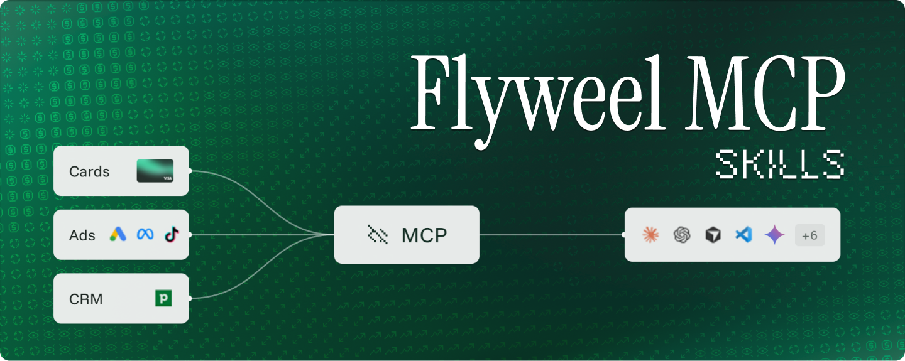

Ask your AI agent about your ad money, in plain words, and get a straight answer.

These are agent skills for [Flyweel](https://flyweel.co). They read your ad platforms, your Flyweel cards and your CRM through the Flyweel MCP server. Then they answer the questions a business owner asks:

- Will my card decline this week?
- How much do I top up to keep the ads running?
- What did last month's ad money bring back?
- Where do I put the next dollar, and where do I take one out?

They are built for businesses where the money goes out long before it comes back. You pay for the ad today. The lead calls next week. The job is signed next month. The invoice is paid the month after. In that gap, most owners are guessing. These skills put numbers on it.

## Install

One command. It works with Claude Code, Cursor, Codex, Gemini CLI, OpenCode and most other coding agents.

```bash
npx skills add flyweel-production/Flyweel-Skills
```

Just one skill:

```bash
npx skills add flyweel-production/Flyweel-Skills --skill flyweel-card-top-up
```

See what is in the box without installing:

```bash
npx skills add flyweel-production/Flyweel-Skills --list
```

As a Claude Code plugin:

```
/plugin marketplace add flyweel-production/Flyweel-Skills
/plugin install flyweel@flyweel
```

The plugin also connects the Flyweel MCP server for you. Run `/mcp` and sign in to Flyweel.

Restart your agent after installing so it picks the skills up.

## Before you start

Five of the six skills need the Flyweel MCP server connected to your agent. The server is how the agent reads your data.

1. Have a [Flyweel](https://flyweel.co) account.
2. Connect the Flyweel MCP server to your agent. See [Connect the server](#connect-the-server) below.
3. Connect at least one ad platform in Flyweel: Google Ads, Meta Ads or TikTok Ads.
4. For the three card skills, have Flyweel cards set up and paying for your ads.
5. A connected CRM is optional. With one, the skills can follow a lead all the way to revenue. Without one, they stop at what the ad platform counts and say so.

Not sure what you have connected? Ask your agent "is everything set up right?" and the `flyweel` skill will tell you.

### Connect the server

Pick your agent below. Each one asks you to sign in to Flyweel the first time. There is no key to copy.

**Claude Code.** Installed the plugin? The server is already added. Run `/mcp` and sign in. Otherwise:

```bash
claude mcp add --transport http flyweel https://api.flyweel.co/functions/v1/mcp-server/mcp
```

**Cursor.** Add this to `~/.cursor/mcp.json`, then sign in from Settings, MCP:

```json
{
  "mcpServers": {
    "flyweel": { "url": "https://api.flyweel.co/functions/v1/mcp-server/mcp" }
  }
}
```

**VS Code (GitHub Copilot).**

```bash
code --add-mcp '{"name":"flyweel","type":"http","url":"https://api.flyweel.co/functions/v1/mcp-server/mcp"}'
```

**Codex.** Adding the server opens the sign-in. If it does not, run `codex mcp login flyweel`.

```bash
codex mcp add flyweel --url https://api.flyweel.co/functions/v1/mcp-server/mcp
```

**Gemini CLI.** Add the server, then run `/mcp auth flyweel` inside Gemini to sign in.

```bash
gemini mcp add --transport http flyweel https://api.flyweel.co/functions/v1/mcp-server/mcp
```

**OpenCode.** Add this to `opencode.json`, then run `opencode mcp auth flyweel`:

```json
{
  "mcp": {
    "flyweel": { "type": "remote", "url": "https://api.flyweel.co/functions/v1/mcp-server/mcp" }
  }
}
```

**Any other agent.** Add a remote MCP server of type HTTP with the address `https://api.flyweel.co/functions/v1/mcp-server/mcp`. Sign in when it asks.

## Two kinds of money

This is the one idea to hold on to.

**What the ad platform reports.** Google, Meta and TikTok each tell you what you spent and what you got. It is fast and detailed, down to the campaign. It is also each platform marking its own homework.

**What your cards paid.** The cash that left your business. It includes tax and fees. It lands a few days after the ads run. It is the number your bank agrees with.

The two are rarely the same. Each skill says which one it uses.

| Skill | Uses |
|---|---|
| `flyweel-card-top-up` | What your cards paid |
| `flyweel-real-cash-payback` | What your cards paid |
| `flyweel-where-to-spend-next` | What your cards paid |
| `flyweel-mcp-deep-ad-analysis` | What the ad platform reports |
| `ad-performance-analyser-flyweel` | Whatever file you give it |

## The skills

### `flyweel`: start here

Use it when you are not sure what to ask. It checks what is connected, sends your question to the right skill, and handles setup jobs like connecting an ad account.

Ask it:

```
"How's my ad money doing?"
"Give me a Monday morning rundown."
"Is everything set up right?"
"What can you do with my Flyweel data?"
```

A rundown has three short parts: what your ad cash brought back, whether your cards are safe for the week, and the one thing worth doing next.

### `flyweel-card-top-up`: keep the ads running

When a card declines, the ads stop. The platform has to relearn who to show them to. That can cost days of leads.

This skill reads how each platform bills your card and how fast you are spending. It works out what will be charged next and tells you what to pay, and by when.

Ask it:

```
"Will anything decline this week?"
"How much do I top up to keep ads running for two weeks? I'm also scaling 20%."
"I can only put 500 in right now. How long does that last?"
"I want to run 4,000 a month through a 1,000 limit. How often do I pay it down?"
"Why was that charge declined?"
"Do I need a higher limit?"
```

You get the answer first, then the working. An example, with made-up figures:

```
Top up 2,400 by Monday to be safe for the next two weeks.
If spend stays normal, 1,400 is enough.

Next 14 days                         Normal pace    Heavy pace
  Your Meta card                         1,690         2,470
  Your Google card                         370           570
  Total charges                          2,060         3,040
  Room left now (credit + limit)         1,370         1,370
  ...
```

It gives a normal case and a heavy case every time. It also catches money you have spent that the platform has not charged yet, which is the usual cause of a surprise decline.

### `flyweel-real-cash-payback`: what the money brought back

For the real cash your cards paid, what did you get? Leads, signups, deals, revenue. What did each one cost? How long did it take to come back?

It goes as deep as your data allows. With a CRM connected, that means signed deals and revenue. Without one, it uses what the ad platform counts and tells you what connecting the CRM would add. Missing data is never treated as zero.

Ask it:

```
"For the cash my cards paid last quarter, what did I get back?"
"What's our real cost per lead?"
"Did September's ad spend pay off?"
"How long does our ad spend take to come back as revenue?"
"How much ad cash is still out?"
```

Every figure is labelled so you know how far to trust it. **Paid** is card cash. **Counted** is a result that passed its checks. **Forecast** is a projection. It ends with a short fix list, such as "38 of 90 signed deals have no amount; fill them in and money back per dollar becomes available."

### `flyweel-where-to-spend-next`: add, hold, trim or cut

Every budget change is a test. Spend went up or down on some day. What did the extra money buy?

This skill finds that day on its own. It then gives one call per ad platform, with a weekly amount.

Ask it:

```
"Meta leads are working. Where do I put more money this week?"
"Did the last budget increase pay off?"
"We're tight on cash. Which ad spend do I cut first?"
```

An example, with made-up figures:

```
Your Meta ads: Add. 100 more a week. The last step up bought 8 more
  leads at 61 each, against 116 each before.
Your Google ads: Cannot see. The card paid 680, but that ad account
  is not connected to Flyweel.
```

It tells you when a result is too thin or too new to act on. It will say "hold, too early to tell" before it will guess.

### `flyweel-mcp-deep-ad-analysis`: your ad review

The weekly look at how the ads are doing, as the platforms report it. Google, Meta and TikTok side by side. What moved, which campaigns carry the results, what to change.

Ask it:

```
"How did Google and Meta do over the last 30 days?"
"Which campaigns are wasting money?"
"Where are my ads sending people?"
```

It counts the result that matters to you, such as leads or signups, and keeps currencies apart. It also checks where your ads send traffic. A domain you do not recognise is a sign the ad account has been taken over.

### `ad-performance-analyser-flyweel`: bring your own file

For data you already have: a CSV export, pasted numbers, a screenshot. Google, Meta, LinkedIn or TikTok. No Flyweel account needed.

Ask it:

```
"Here's last month's campaign export. Cost per lead jumped. Why?"
"Write me a monthly ad report from this."
"How should I split next month's budget between Google and Meta?"
```

## How the skills work together

You do not need to pick. Ask your question and your agent chooses. A common week looks like this:

1. **Monday:** "How's my ad money doing?" gives the rundown.
2. **A platform looks good:** "Where do I put more?" gives an amount.
3. **Before you raise the budget:** "Can the cards carry that?" gives a top-up and a date.
4. **Month end:** "Did it pay off?" gives what the cash bought.

## What to expect

**Answers in plain words.** The answer comes first, in one sentence. The numbers follow in a small table so you can check them.

**The same question gets the same number.** Each skill follows fixed rules, so two people asking on the same day land on the same figure. Where a number rests on a guess, the guess is named.

**It says what it cannot see.** If an ad account is not connected, or your CRM is missing deal amounts, the skill tells you, and tells you what fixing it would add.

**It will not change anything without asking.** The skills read your data. A few can do something, such as raise a card budget. Those show you a preview first and act only after you say yes.

## What the skills cannot do

- **Make a payment or raise your limit.** They give you the amount and the date. You pay in the Flyweel app.
- **Tell you which ad account a card pays.** The card statement shows the platform, not the ad account. So money is worked out per platform. Campaigns are shown as counts of results, never with a cost.
- **See an ad account you have not connected.** Cash that went to one is listed on its own line, with no cost per result.
- **Know your plans.** A budget increase counts only if you mention it.
- **Forecast far ahead.** Past two weeks, a forecast is a rough guide. Ask again each week.

## Update or remove

```bash
npx skills update                       # get the latest version of every skill
npx skills remove flyweel-card-top-up   # remove one
npx skills list                         # see what is installed
```

## Something not working?

| What you see | What to do |
|---|---|
| The agent does not use a skill | Restart the agent. Then name the skill: "use flyweel-card-top-up". |
| "Cards are not set up" | The three card skills need Flyweel cards. The other skills still work. |
| "No CRM is connected" | That is fine. The skill carries on with what the ad platform counts. Connect a CRM in Flyweel to go deeper. |
| A platform shows as "cannot see" | The card paid that platform, but its ad account is not connected or not selected in Flyweel. |
| Numbers look a day old | Each answer says when the data was last updated. Ask your agent to sync if you need it fresher. |
| The agent asks you to sign in | The Flyweel connection has timed out. Sign in again and repeat the question. |

## For contributors

The skills are plain text files. Each lives in `skills/<name>/SKILL.md`. See [CONTRIBUTING.md](CONTRIBUTING.md) for how to test a change, and `evals/evals.json` for the questions each skill is checked against.

Found a security problem? See [SECURITY.md](SECURITY.md).

## Built by Flyweel

[Flyweel](https://flyweel.co) treats ad spend as an investment. Clear on what comes back. In control of where it goes. Funded to match when the money lands.

## License

Apache License 2.0. See [LICENSE](LICENSE).
